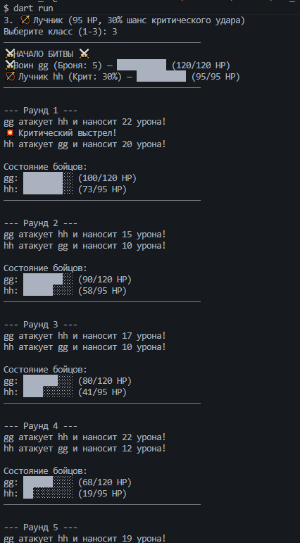

# Лабораторная работа №7. Углублённое ООП в Dart — RPG-битва

* **Выполнил:** Шкурский Максим
* **Группа:** ИСП-242
* **Дата сдачи:** 13.11.2026

## Описание проекта
Консольная пошаговая RPG-игра, написанная на чистом Dart. Игрок и противник выбирают себе имя и один из трех классов (Воин, Маг, Лучник), после чего они бьются в пошаговом режиме до полной победы одного из них.

## Что я изучил в этой лабе:
1. Понял, как работают абстрактные классы и зачем они нужны (создали общий шаблон `Character`, от которого нельзя сделать объект напрямую).
2. Разобрался с наследованием (`extends`) и ключевым словом `super` для вызова конструкторов и методов родительского класса.
3. Научился использовать полиморфизм на практике: метод `battle` принимает общие типы `Character`, но программа сама понимает, чьи конкретно методы атаки или получения урона вызывать прямо во время боя.
4. Закрепил работу с инкапсуляцией (скрыли генератор рандома через нижнее подчёркивание).

## Финальный скриншот битвы

## Запуск
1. Клонировать репозиторий: `git clone <url>`
2. Перейти в папку: `cd lab_rpg_shkurskii`
3. Установить зависимости: `dart pub get`
4. Запустить: `dart run`

## Ответы на вопросы к защите:

1. **Что такое абстрактный класс? Почему нельзя написать Character() напрямую?**
Абстрактный класс — это класс-шаблон, у которого нет полной реализации и который создан только для того, чтобы от него наследовались другие. Написать `Character()` напрямую нельзя, потому что в игре нет «просто абстрактного персонажа», у него обязательно должен быть конкретный класс (Воин, Маг или Лучник) со своей логикой атаки.

2. **Зачем нужен super в конструкторе наследника? Что будет, если его убрать?**
`super` нужен для того, чтобы передать данные (например, имя и стартовое здоровье персонажа) наверх, в конструктор родительского класса `Character`, чтобы он сам их инициализировал. Если его убрать, программа выдаст ошибку компиляции, так как базовый класс не получит обязательные данные для своего создания.

3. **В чём разница между @override у attack() в Warrior и takeDamage() в Warrior? Почему второй переопределяет метод, который уже имеет реализацию в родителе?**
Метод `attack()` у родителя вообще не имеет тела (он абстрактный), поэтому Воин обязан написать его реализацию с нуля. А метод `takeDamage()` в родителе уже имеет общую рабочую логику, но Воин переопределяет его, чтобы добавить туда свое уникальное свойство — уменьшение урона за счет брони, после чего докидывает остаток урона базовому методу через `super.takeDamage()`.

4. **Функция fight(Character a, Character b) не знает, кто реально придёт — Warrior, Mage или Archer. Как называется эта концепция и где вы её уже видели во Flutter?**
Эта концепция называется полиморфизм. Во Flutter мы постоянно видим её в методе `build(BuildContext context)`, который возвращает общий тип `Widget`, хотя внутри функции мы можем вернуть любой его дочерний элемент — `Text`, `Column`, `Container` или `SizedBox`.

5. **Что означает _random с нижним подчёркиванием в классе Character?**
Нижнее подчёркивание в Dart делает переменную или метод приватными (private). Это значит, что к `_random` можно обращаться только внутри самого файла `character.dart`, а из других файлов или классов напрямую залезть в него и сломать логику генерации чисел нельзя.
